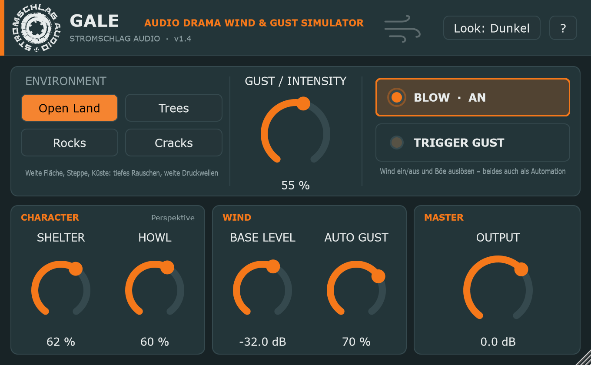
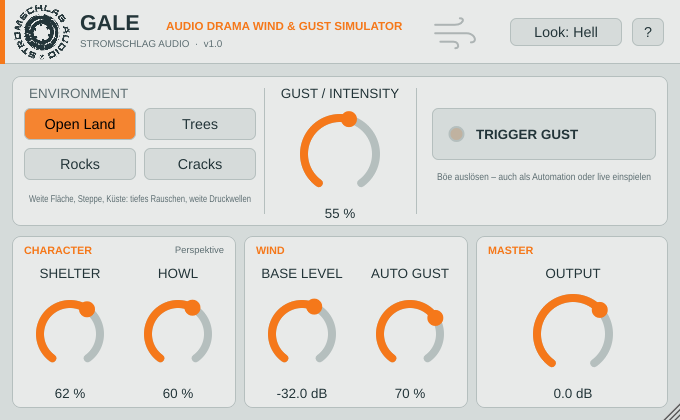

# GALE – Audio Drama Wind & Gust Simulator <picture><source media="(prefers-color-scheme: dark)" srcset="docs/symbol-dunkel.png"></picture>

<picture>
  <source media="(prefers-color-scheme: dark)" srcset="docs/logo-dunkel.png">
  
</picture>

VST3-Effekt für Hörspiel-Produktion. GALE erzeugt Wind, Luftströmung und Böen in Echtzeit, ganz ohne Samples. Du setzt
eine Böe punktgenau auf einen Satz im Dialog, lässt den Wind zufällig aufleben oder fährst mit **einem** Regler von
draußen im Sturm bis in den geschützten Innenraum.

**⬇ Download (Windows · VST3 · Stereo):** https://github.com/StromschlagProductions/Gale-vst/releases/latest

## Warum es dieses Plugin gibt

In meinem Hörspiel in Australien zieht ein Hurrikan auf. In vielen Szenen hört man den Sturm, bestenfalls so, dass
Böen vorbeihuschen, und in einem Labor mit Blechgehäuse rappelt und klappert es, der Wind jault und pfeift in den
Ritzen. Mit Samples ist das schwierig: Ich habe eine Windspur von ein paar Minuten, die sehr realistisch klingt, auch
mit Ästen und Knistern. Aber genau an der Stelle, an der der Wind bei einem bestimmten Satz aufheulen soll, habe ich
keine Böe. Und eine Spur, die sich irgendwann wiederholt, ist auf die Dauer kein Hintergrund.

GALE löst das mit einem prozeduralen Wind. Er läuft ohne Loop und ohne Wiederholung, ich kann eine Böe auf den Punkt
auslösen (per Automation, mit einem Klick beim Einspielen oder auf Wunsch zufällig) und mit einem Regler zwischen
draußen und drinnen wechseln, ohne eine ganze Kette aus Filtern und Hallräumen zu bauen. Meine echte Windaufnahme darf
leise darunter bleiben, mit allen Details. GALE liefert die Böen, das Heulen und das Rappeln dazu.

GALE ist ein Werkzeug für meinen eigenen Alltag in der Hörspielproduktion, entstanden aus dem, was ich in solchen Szenen
immer wieder gebraucht habe.

*GALE soll niemandem die Erfahrung abnehmen, Wind und Sturm selbst zu gestalten. Es kann viel Spaß machen und lehrreich
sein, Böen mit Filtern, Automation und eigenen Aufnahmen aufzubauen und zu hören, wie Luftdruck, Pfeifen, Wand und Raum
ineinandergreifen. Ich bin dankbar, dass ich diesen Weg selbst gegangen bin – auch wenn er manchmal umständlich war.
GALE soll das Gestalten nicht ersetzen, sondern die technische Umsetzung im Alltag einfacher machen.*

– Lars Eickstädt, Stromschlag Audio

## Oberfläche

| Dunkel (Standard) | Hell |
|---|---|
|  |  |

Der Umschalter oben rechts wechselt den Look, die Wahl wird mit dem Projekt gespeichert. Der **?**-Knopf
öffnet die Hilfe, über jedem Regler erscheint beim Darüberfahren ein kurzer Hinweis.

Die Oberfläche lässt sich am rechten unteren Fensterrand stufenlos von 50 % bis 300 % vergrößern oder
verkleinern. Das Seitenverhältnis bleibt dabei fest.

## So ist es gedacht

- GALE kommt auf einen **FX-Kanal oder Bus**. Es braucht kein Eingangssignal und kein MIDI: Der Wind entsteht selbst.
  Was am Eingang anliegt, läuft unverändert durch, der Wind kommt dazu. Von dort gehst du wie gewohnt weiter, zum
  Beispiel in Spatial Lab für den Raum der Szene.
- **BLOW** schaltet den Wind an und aus, weich ein- und ausgeblendet und ebenfalls automatisierbar. So beginnt und endet der
  Wind in einer langen Szene genau dort, wo er gebraucht wird.
- **GUST / INTENSITY** ist der Regler, den du automatisierst: die laufende Windstärke der Szene.
- **TRIGGER GUST** setzt die einzelne, gezielte Böe. Der Taster ist auch ein Automationsparameter. Ein kurzer Sprung von 0 auf 1
  löst die Böe genau dort aus, ihren Verlauf (anschwellen, abklingen) macht GALE selbst. Live geht es auch: Automation auf
  Touch oder Write, Szene laufen lassen und beim richtigen Satz klicken.
- **AUTO GUST** lässt zusätzlich zufällig Böen vorbeiziehen, in einstellbarer Häufigkeit und Stärke. Gezielte Böen kommen oben drauf.
- **SHELTER** ist die Perspektive: draußen, hinter Fenster oder Zeltwand, tief im Gebäude.

## Umgebungen

| ENVIRONMENT | Wann nehmen | Klang |
|---|---|---|
| Open Land | Steppe, Küste, Outback, offene Fläche | Breites, tiefes Rauschen mit weiten, langsamen Druckwellen |
| Trees | Bäume, Büsche, Laub | Weiches Rauschen vieler Blätter; mehrere Äste wogen unabhängig voneinander, mit der Böe schneller und kräftiger |
| Rocks | Felswand, Schlucht, Canyon | Hohle Resonanzen, die bei steigender Windstärke nach oben jaulen |
| Cracks | Türspalt, Fensterritze, Zugluft | Schmalbandiges, schneidendes Pfeifen und Luftzug |

Beim Umschalten blendet GALE weich über, die Umgebung lässt sich also auch mitten in der Szene automatisieren.

## Regler (alle automatisierbar)

**Oben**

| Regler | Wirkung |
|---|---|
| ENVIRONMENT | Open Land, Trees, Rocks oder Cracks (siehe oben) |
| GUST / INTENSITY | **der Hauptregler**: laufende Windstärke. Steuert gemeinsam Lautstärke, Luftdruck, Pfeifton und Stereo-Bewegung. Ganz unten bleibt nur der leise Grundwind |
| BLOW | Wind an oder aus (Schalter mit LED, zugleich Automationsparameter). Blendet in ca. 1,5 s ein und legt sich beim Ausschalten in ca. 2,5 s |
| TRIGGER GUST | löst eine einzelne Böe aus (Taster mit LED, zugleich Automationsparameter) |

**Unten, in drei Kästen**

| Kasten | Regler | Wirkung |
|---|---|---|
| **CHARACTER** | SHELTER | 0 % draußen (volles Spektrum, direkte Turbulenzen), ca. 50 % hinter Fenster oder Zeltwand (Höhen gedämpft, tiefes Wummern der Scheibe), 100 % tief im Gebäude (starker Tiefpass, tiefes Grollen, Pfeifen in den Ritzen). Mit Abstand zum Freien kommt das Rappeln von großem Blech dazu: Wellblech und Blechwände mit tiefen, lang nachschwingenden Schlägen und schlackernden Platten. Der Wind drückt als ungleichmäßiges Grollen gegen die Wände |
| | HOWL | Heulen und Pfeifen: 0 % reines Rauschen, 100 % ein deutlicher, wandernder Ton, der mit den Böen steigt. Der Klang folgt ENVIRONMENT, die Gesamtlautstärke bleibt etwa gleich. Bei hohem SHELTER bestimmt HOWL auch das Pfeifen in den Ritzen |
| **WIND** | BASE LEVEL | Lautstärke des dauerhaften Grundwinds, der digitale Stille verhindert (in dB, entspricht etwa dessen Lautheit; ganz links aus) |
| | AUTO GUST | Häufigkeit und Kraft zufälliger Böen (ganz links aus) |
| **MASTER** | OUTPUT | Pegel des Windes (der Eingang bleibt unberührt) |

**Presets** (erscheinen in der Preset-Liste des Hosts, setzen nur die Regler): Outback Stillness, Sudden Desert Gust, Howling Canyon,
Storm Outside Cabin, Drafty Doorway, Approaching Tempest und Blechlabor im Sturm.

## Anwendung

**Sturm über dem Blechlabor:** FX-Kanal mit GALE. ENVIRONMENT = Open Land, SHELTER ca. 60 %, HOWL ca. 60 %, AUTO GUST ca. 70 %.
GUST / INTENSITY mit dem Sturm der Szene mitfahren. Bei den Sätzen, auf denen der Wind aufheulen soll, TRIGGER GUST auslösen.
Die Außenszene vor der Tür ist derselbe Kanal mit SHELTER auf 0 %.

**Rein oder raus:** SHELTER von 0 auf 100 % ziehen, wenn die Figur ins Gebäude geht und die Tür hinter sich schließt. Auf dem Weg
dahin wird der Wind dumpfer, das Wummern der Wand kommt, zuletzt das tiefe Grollen.

**Sturm zieht auf:** GUST / INTENSITY und AUTO GUST über die Szene langsam hochziehen, HOWL dazunehmen (siehe Preset „Approaching Tempest“).

**Zugluft an der Tür:** ENVIRONMENT = Cracks, SHELTER ca. 30 %, HOWL hoch. Böen mit TRIGGER GUST von Hand setzen.

**Stille Außenszene:** BASE LEVEL und GUST niedrig, AUTO GUST etwas an: Ein leises Grundbett mit gelegentlichen Windzügen („Outback Stillness“).

**Zusammen mit echten Aufnahmen:** Die echte Windspur leise darunter lassen. GALE liefert Böen, Heulen und Rappeln auf den Punkt.

## Installation (Windows)

1. Über den Download-Link oben `Gale-VST3-Windows.zip` laden.
2. ZIP entpacken und den **ganzen Ordner** `Gale.vst3` nach `C:\Program Files\Common Files\VST3` kopieren.
3. DAW neu starten bzw. Plugins neu scannen.

## Versionen

Die Versionsnummer steht in der Datei `VERSION`, im Plugin-Kopf und im Namen der Release. Sie wird bei jeder Änderung hochgezählt (1.0, 1.1, 1.2 …).

- **1.4** – Lizenzhinweis liegt im Plugin-Ordner (`Contents/Resources`) statt neben dem ZIP-Inhalt; Klang und Projektkompatibilität unverändert. [Release-Hinweise](docs/releases/1.4.md).
- **1.3** – Einheitliche öffentliche Versionsnummer ohne Build-Suffix; Audioverarbeitung und Projektkompatibilität unverändert. [Release-Hinweise](docs/releases/1.3.md).
- **1.2** – Zuverlässige Trigger auch bei großen Monoblöcken und schnellen Klickfolgen, sichere Fenster-Metadaten und weniger redundante Filterberechnungen. BLOW-Verlauf und Klang bleiben erhalten, weiterhin 0 ms Latenz. [Technische Prüfung](docs/TECHNICAL_REVIEW.md).
- **1.1** – BLOW (Wind an/aus mit weichem Ein- und Ausblenden), Trees neu als weiches Blätterrauschen, HOWL deutlich hörbar, Blech-Rappeln als großes, tiefes Wellblech, Druck auf die Wände nach dem Rauschkern von Airwindows „Noise“. [Release-Hinweise](docs/releases/1.1.md).
- **1.0** – Erste Version: GUST / INTENSITY, TRIGGER GUST, AUTO GUST, vier Umgebungen, SHELTER mit Wand-Wummern, Sub-Grollen, Ritzen-Pfeifen und Blech-Rappeln, HOWL, BASE LEVEL, OUTPUT, sieben Presets. Hell/Dunkel, skalierbare Oberfläche, Hilfe. [Release-Hinweise](docs/releases/1.0.md).

## Aufbau

- `Source/GaleDSP.h`: Klang-Engine (reines C++ ohne JUCE, samplefrei)
- `THIRD_PARTY_NOTICES.md`: Lizenztext für den übernommenen Airwindows-Rauschkern (liegt im Download im Plugin-Ordner unter `Contents/Resources`)
- `Source/PluginProcessor.*`, `Source/PluginEditor.*`: JUCE-Plugin und Oberfläche
- `tools/render_demo.cpp`, `tools/analyze.py`: rendert Hörbeispiele aus der echten Engine und misst sie (Lautheit, Spitze, Stereo/Mono, Spektrogramme)
- `.github/workflows/build.yml`: Windows-Bau mit Tests und Stabilitätstest (pluginval) bei jeder Änderung; Release nur von Hand mit Haken „publish“, siehe [docs/CI.md](docs/CI.md) und [docs/PUBLISHING.md](docs/PUBLISHING.md)

## Qualität und Prüfung

Wenige Regler heißen nicht, dass hier etwas schnell zusammengeschustert wurde. Die Einfachheit liegt in der Bedienung, nicht in der Technik dahinter. Jede Version durchläuft Prüfungen, wie sie auch bei kommerziellen Plugins üblich sind, und alles ist im Quellcode nachvollziehbar:

- **pluginval, Stufe 8:** Vor jeder Veröffentlichung läuft das Prüfprogramm pluginval von Tracktion auf strenger Stufe. Es lädt das Plugin wieder und wieder, wechselt Abtastraten und Puffergrößen, speichert und lädt Einstellungen und fährt alle Regler mit Zufallswerten durch.
- **Automatische Tests der Klangberechnung** laufen bei jeder Änderung. Sie prüfen unter anderem alle Abtastraten von 22,05 bis 192 kHz, alle vier Umgebungen, ungültige Werte, Auslösen und Abklingen der Böen, Stereo und Mono sowie den Durchlauf des Eingangs. Außerdem laufen sie mit Speicher- und Fehlerprüfern (AddressSanitizer, UndefinedBehaviorSanitizer), die auch seltene Programmierfehler aufspüren.
- **Echtzeitsicher:** Während der Wiedergabe wird kein Speicher angefordert und nirgends gewartet. Das verhindert Aussetzer und Knackser, auch bei kleinen Puffern und vielen Instanzen. Das Ergebnis ist unabhängig davon, wie der Host den Audiostrom in Blöcke teilt.
- **Mono-kompatibel:** Links und Rechts sind unabhängige Rauschquellen. Die Bewegung der Böen entsteht durch zeitversetzte Steuerkurven, nie durch verzögertes Audio. Die Mono-Summe löscht sich deshalb nicht aus und klingt nicht hohl.
- **Saubere Übergänge:** Alle Regler gleiten, die Umgebung blendet weich über. Beim Automatisieren knackt nichts. Ein Klick auf TRIGGER GUST geht auch bei sehr kurzem Druck nicht verloren.
- **Keine Latenz.** Mono- und Stereospuren werden korrekt verarbeitet, der Eingang läuft unverändert durch.
- **Kein Loop, kein Speicherbedarf:** Der Wind entsteht aus Rauschen und Filtern und wiederholt sich nie. Es sind keine Audiodateien eingebettet.
- **Pegel nach Messung abgestimmt:** Die Umgebungen sind bei gleicher Windstärke nach Lautheit (LUFS) angeglichen, die Standardeinstellung liegt bei etwa −30 LUFS als Grundbett unter Dialog. Die Hörbeispiele werden aus derselben Engine gerendert und nachgemessen.

Ob es gut klingt, entscheidet am Ende das Ohr. Deshalb geht jede Version auch durch den Studioalltag von Markus Hildebrandt (siehe unten).

## Beta-Test und Danke

**SOUNDJOB / Markus Hildebrandt** – Beta-Testing

Ein großes Dankeschön an **Markus Hildebrandt** von SOUNDJOB. Markus betreibt ein eigenes Tonstudio und hat weit mehr Hörspiele produziert als ich. Er testet GALE im Studioalltag und gibt mir ehrliches, fachkundiges Feedback. Ein Plugin für Wind steht und fällt mit dem Gehör, und seine Erfahrung ist dafür unersetzlich.

Gebaut mit [JUCE](https://juce.com) 8. Das tiefe Druck-Rauschen hinter Wänden beruht auf dem Rauschkern von
[Airwindows](https://github.com/airwindows/airwindows) „Noise“ von Chris Johnson (MIT-Lizenz) – handgemachte, freie
Plugins, von denen ich viel halte.

---

## Hinweis / Disclaimer

**Open Source · Work in Progress**

Dieses Plugin wurde in erster Linie für meinen persönlichen Workflow bei der Hörspielproduktion entwickelt. Es ist auf meine eigenen Anforderungen zugeschnitten und muss daher nicht für jeden Anwendungsfall geeignet sein.

Das Projekt wird laufend weiterentwickelt. Trotz sorgfältiger Tests können Fehler oder Kompatibilitätsprobleme auftreten. Die Software wird ohne Gewährleistung bereitgestellt; die Nutzung erfolgt auf eigene Verantwortung. Eine Haftung für mögliche Schäden oder Datenverluste wird, soweit gesetzlich zulässig, ausgeschlossen. Es gelten die jeweiligen Lizenzbedingungen.

**Feedback, Fehlermeldungen und Verbesserungsvorschläge sind herzlich willkommen!**

Wenn dieses kleine Werkzeug auch anderen die Hörspielarbeit erleichtert und mehr Raum für Geschichten und menschliche Kreativität schafft, freut mich das ganz besonders.

Öffentliches Versionsschema und Release-Ablauf: [Versionsnummern](docs/VERSIONING.md).
